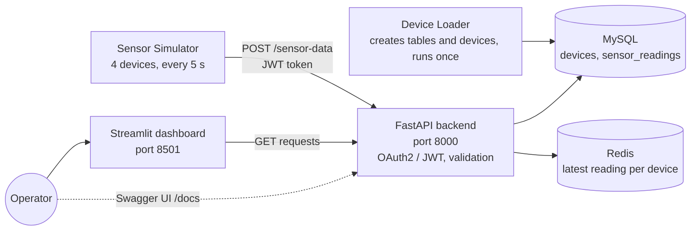

# System Architecture

## Overview

The platform collects temperature and humidity readings from simulated industrial sensors, stores them and presents them on a live dashboard. It follows a microservice approach: each component runs in its own Docker container, and the containers communicate over an internal Docker network (`iot-network`).

## Components

### Dashboard (`dashboard/`)

A Streamlit application that shows system metrics, the device registry and the latest reading of a selected device. It refreshes every 2 seconds and accesses data exclusively through the API, never directly through the databases.

### API (`api/`)

The FastAPI backend is the central component. It

- authenticates clients with OAuth2 (password flow) and issues JWT access tokens that expire after 30 minutes,
- validates incoming readings with Pydantic models,
- writes each reading to MySQL and updates the Redis cache,
- serves the device registry, the latest readings and summary statistics.

### Storage

The design uses one relational database plus a cache, which keeps operation simple while covering both history and fast access:

- **MySQL**
  - `devices`: device registry (name, location, active flag)
  - `sensor_readings`: append-only time series of all readings, indexed by device and timestamp
- **Redis**
  - `last_reading:{device_id}`: the most recent reading of each device, used for fast dashboard queries

### Background services

- **Sensor Simulator (`sensor-simulator/`)**: logs in to the API, then sends one reading every 5 seconds for a randomly chosen device. Each device has its own value range (server room, cold storage unit, warehouse zone, generator room). When a token expires, the simulator logs in again.
- **Device Loader (`device-loader/`)**: runs once at startup, waits for MySQL, creates the tables if they do not exist and registers the four devices.

## Data flow

### Write path

1. The simulator requests a token at `POST /token`.
2. It sends each reading to `POST /sensor-data` with the token in the `Authorization` header.
3. The API stores the reading in `sensor_readings` (MySQL).
4. The API updates `last_reading:{device_id}` in Redis.

### Read path

1. The dashboard calls `GET /sensor-data/latest/{device_id}`.
2. The API returns the cached value from Redis if available.
3. On a cache miss, the API queries the latest record from MySQL.

## Security

- OAuth2 with JWT access tokens protects the data ingestion endpoint.
- All credentials and the token signing key are read from a `.env` file; no secrets are stored in the code.
- Redis requires a password, and MySQL and Redis are reachable only inside the Docker network.
- Docker Compose health checks make sure dependent services start only when MySQL, Redis and the API are ready.
