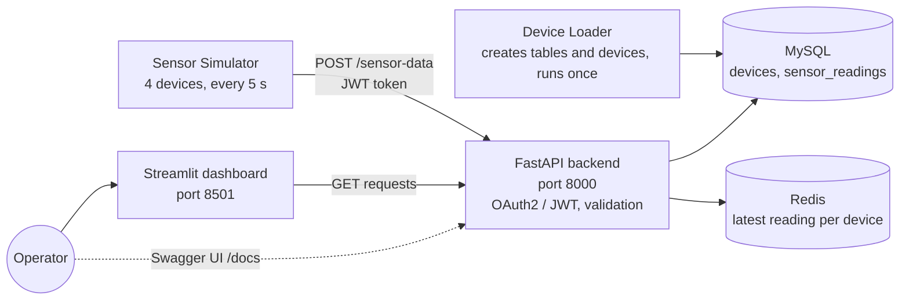

# Industrial IoT Cloud Management System

How can sensor data from a factory or warehouse be collected securely, stored reliably and shown live to an operator? This project answers that with a small cloud platform built from Docker microservices: simulated sensors send temperature and humidity readings to a secured API, which stores the full history in MySQL, keeps the latest values in Redis and serves them to a live dashboard.

## Highlights

- **Five services, one command**: MySQL, Redis, a FastAPI backend, a sensor simulator and a Streamlit dashboard, orchestrated with Docker Compose, including health checks and startup order
- **Secured data ingestion**: sensors must log in with OAuth2 and send a JWT bearer token with every reading. Tokens expire after 30 minutes and the simulator renews them automatically.
- **Storage and cache**: every reading is appended to MySQL as history, while Redis holds the latest reading per device, so the dashboard reads fast and falls back to MySQL on a cache miss
- **Realistic sensor profiles**: four devices with different value ranges, e.g. a cold storage unit (-5 to 5 °C, 80–90% humidity) and a warehouse zone (20–30 °C, 40–60% humidity), one reading every 5 seconds
- **Live dashboard**: system metrics (total readings, average and maximum temperature, average humidity), the device registry and the latest values of a selected device, refreshed every 2 seconds
- **No secrets in the code**: all credentials and keys are read from a `.env` file

## Architecture



The dashboard never connects to a database directly; all reads and writes go through the API.

**Write path:** the simulator logs in at `POST /token`, sends each reading to `POST /sensor-data`, and the API stores it in MySQL (`sensor_readings`) and updates the Redis key `last_reading:{device_id}`.

**Read path:** the dashboard calls `GET /sensor-data/latest/{device_id}`. The API answers from Redis and only queries MySQL if the cache is empty.

## API endpoints

| Method | Endpoint | Description | Auth |
|---|---|---|---|
| `POST` | `/token` | Log in and receive a JWT access token | – |
| `POST` | `/sensor-data` | Submit a reading (`device_id`, `temperature`, `humidity`) | Bearer token |
| `GET` | `/sensor-data/latest/{device_id}` | Latest reading of a device (Redis first, MySQL fallback) | – |
| `GET` | `/devices` | Device registry | – |
| `GET` | `/stats/summary` | Total readings, average and maximum temperature, average humidity | – |
| `GET` | `/health` | Health check used by Docker Compose | – |

Interactive documentation is available at `http://localhost:8000/docs`.

## Project structure

| Path | Description |
|---|---|
| `api/` | FastAPI backend: authentication, validation, MySQL and Redis access |
| `sensor-simulator/` | Generates readings for four devices and sends them to the API |
| `device-loader/` | Creates the MySQL tables and registers the devices (runs once at startup) |
| `dashboard/` | Streamlit dashboard |
| `docker-compose.yml` | Defines all services, the network, volumes and health checks |
| `.env.example` | Template for all required environment variables |
| `Architecture.md` | Detailed description of the architecture and data flow |

## How to run

Requirements: Docker Desktop (or Docker Engine with Docker Compose).

1. Create the environment file and fill in every value:

   ```bash
   cp .env.example .env
   ```

   | Variable | Purpose |
   |---|---|
   | `MYSQL_ROOT_PASSWORD`, `MYSQL_DB`, `MYSQL_USER`, `MYSQL_PASSWORD` | MySQL database and credentials |
   | `MYSQL_HOST`, `MYSQL_PORT` | Use `mysql` and `3306` inside Docker |
   | `REDIS_PASSWORD`, `REDIS_HOST`, `REDIS_PORT` | Use `redis` and `6379` inside Docker |
   | `SECRET_KEY` | Long random string used to sign JWT tokens |
   | `ADMIN_PASSWORD` | Password of the `admin` user (also used by the simulator) |

2. Start all services:

   ```bash
   docker compose up --build
   ```

3. Open the dashboard at `http://localhost:8501` and the API documentation at `http://localhost:8000/docs` (log in as `admin` with your `ADMIN_PASSWORD`).

## Limitations and next steps

- There is a single admin user defined in the API; a real deployment would need a user table and per-device credentials.
- Only writing data requires a token; the read endpoints are open.
- The `/health` endpoint does not test the database connections, so the dashboard's status panel reflects API availability only.
- The dashboard shows the latest values but no history charts yet; time-series plots and alert thresholds (e.g. for the cold storage unit) are natural next steps.
- Sensor data is simulated. Real devices could send data over MQTT through a gateway into the same API.

**Author:** Mehdi Gurbanzade · M.Sc. Data Science
